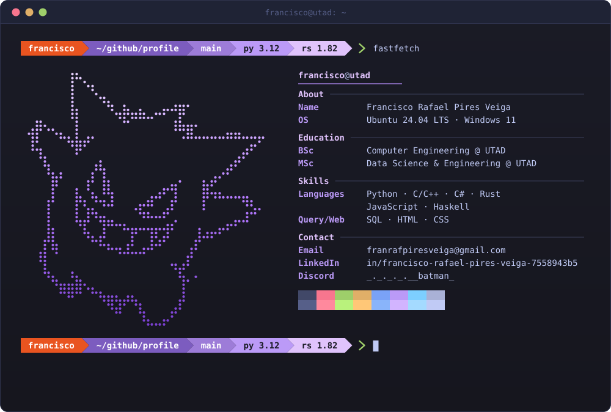

# Francisco Rafael Pires Veiga

 

[🇬🇧 English](#english) · [🇵🇹 Português](#portugues)

---

## 🇬🇧 English

### About me

Computer Engineering graduate from the University of Trás-os-Montes and Alto Douro (UTAD), currently pursuing a Master's degree in Data Science & Engineering at the same institution. I have a solid foundation in software development across several programming paradigms, from systems-level languages to functional and data-oriented ones, and I work comfortably in both Linux and Windows environments.

### Looking for challenges

I am actively seeking new challenges, including professional opportunities, internships and collaborative projects, where I can apply my technical background, keep learning, and grow in the fields of software development and data engineering.

### Education

| Degree | Institution | Status |
| :-- | :-- | :-- |
| MSc in Data Science & Engineering | UTAD | In progress |
| BSc in Computer Engineering | UTAD | Completed |

### Skills

**Languages** 
         

**Operating systems** 
 

### Contact

---

## 🇵🇹 Português

### Sobre mim

Licenciado em Engenharia Informática pela Universidade de Trás-os-Montes e Alto Douro (UTAD), encontro-me atualmente a frequentar o Mestrado em Engenharia e Ciência de Dados na mesma instituição. Possuo uma base sólida em desenvolvimento de software em vários paradigmas de programação, desde linguagens de baixo nível a linguagens funcionais e orientadas a dados, e trabalho com à-vontade em ambientes Linux e Windows.

### À procura de desafios

Encontro-me à procura de novos desafios, nomeadamente oportunidades profissionais, estágios e projetos colaborativos, nos quais possa aplicar a minha formação técnica, continuar a aprender e evoluir nas áreas do desenvolvimento de software e da ciência de dados.

### Formação

| Grau | Instituição | Estado |
| :-- | :-- | :-- |
| Mestrado em Engenharia e Ciência de Dados | UTAD | Em curso |
| Licenciatura em Engenharia Informática | UTAD | Concluída |

### Competências

**Linguagens** 
         

**Sistemas operativos** 
 

### Contactos

 

